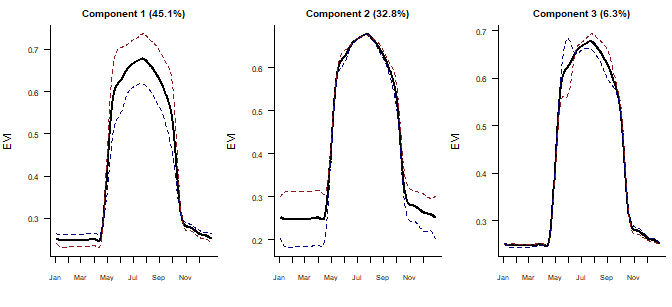

# How Vegetation Greens and Fades Through the Year

A functional data analysis of satellite vegetation readings. Each of 200 locations has a year of Enhanced Vegetation Index (EVI) readings taken every eight days. Instead of treating those as 46 separate numbers, the analysis treats each location's year as one smooth curve and asks what a typical growing season looks like, when greening is fastest, and how locations differ.

**[Read the full report](evi_fda.md)**. Written in R with the `fda` package and rendered with Quarto.



## Findings

- **The typical year.** EVI sits at about 0.25 through winter, greens up fastest around 2 May, peaks around 22 July at about 0.68, and falls fastest around 10 October.
- **How locations differ.** Three components explain 84.2% of the variation between locations:
  - Component 1 (45.1%): height of the summer peak
  - Component 2 (32.8%): how green a location stays in winter
  - Component 3 (6.3%): timing of green-up
- **Smoothing the components did not help.** 10-fold cross-validation showed that penalties up to λ = 100 rebuild unseen curves equally well, and larger penalties do worse. The sharp May feature in component 3 is therefore real variation in green-up timing, not noise.

## Method

1. **Smoothing.** Each location's readings were turned into a curve with a roughness penalty, comparing a curvature penalty (B-splines) with a harmonic acceleration penalty (Fourier basis). The harmonic penalty leaves a pure annual cycle unpenalised. Smoothing levels were chosen by generalised cross-validation (GCV).
2. **Rates of change.** First and second derivatives of the curves give the speed of greening and where it switches on and off.
3. **Functional PCA.** Components were found with and without a roughness penalty, with the penalty chosen by 10-fold cross-validation on held-out curves.

All numbers in the report and above are calculated when the report is rendered.

## How to run

```r
install.packages(c("fda", "tidyverse", "quarto"))
quarto::quarto_render("evi_fda.qmd", output_format = "all")
```

This produces `evi_fda.md`, the GitHub-readable report with figures, and `evi_fda.pdf`. The PDF needs a LaTeX installation, for example `tinytex`.

## Files

```
evi_fda.qmd                      Report source: analysis code and text
evi_fda.md                       Rendered report for GitHub
evi_fda_files/figure-commonmark/ Figures used by the report
data/evi_data.csv                200 locations x 46 EVI readings (columns Day4 ... Day364)
```

Originally a course project for Functional Data Analysis, University of Glasgow (2026). This version adds a full write-up and cross-validated smoothing of the components.
