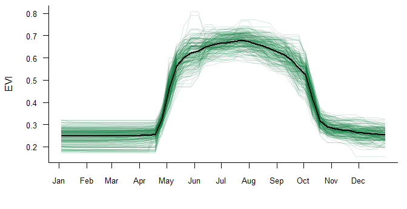
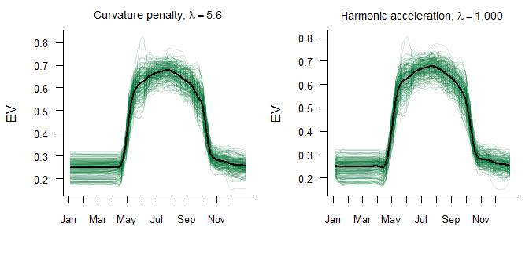
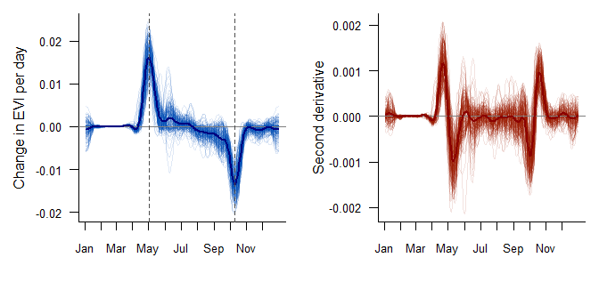
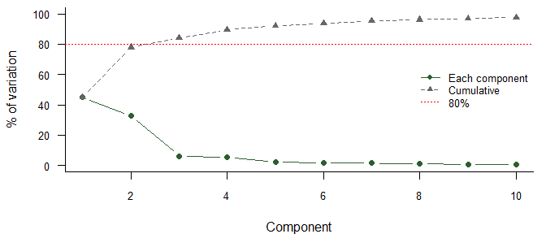
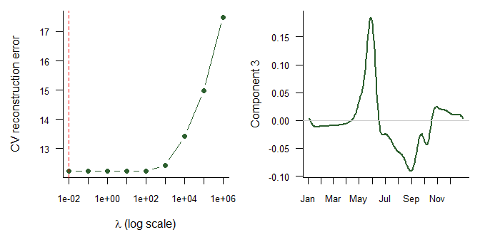
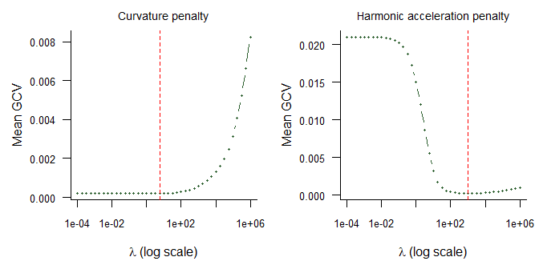

# How Vegetation Greens and Fades Through the Year
Ahmed Mohamed
October 2026

## Summary

Satellite readings of vegetation greenness at 200 locations were treated
as 200 smooth curves, one per location, so that the shape of each
growing season could be analysed rather than 46 separate numbers.

- **The typical year.** The average location sits at an EVI of about
  0.25 through winter, greens up fastest around **2 May**, peaks around
  22 July at about 0.68, and fades fastest around **10 October**.
- **How locations differ.** Three components explain **84.2%** of the
  differences between locations: the height of the summer peak (45.1%),
  how green a location stays in winter (32.8%), and the timing of
  green-up (6.3%).
- **How the settings were chosen.** Smoothing levels were chosen by
  generalised cross-validation, and the penalty on the components by
  10-fold cross-validation on curves held out from the fit.

## 1. Introduction

The Enhanced Vegetation Index (EVI) is a satellite measure of how green
and dense vegetation is: higher values mean more active, leafy
vegetation. Measured every eight days, it traces out each location’s
growing season.

Treating the 46 readings as one curve per location makes it possible to
ask questions about the *shape* of the season:

1.  What does a typical growing season look like?
2.  When does vegetation green up and fade fastest?
3.  In what main ways do locations differ from one another?

## 2. Data

The data hold 46 readings per location, every eight days from day 4 to
day 364 of a single year, for 200 locations. There are no missing
values. Readings range from 0.16 to 0.81. No information is available on
where the locations are or what vegetation grows there.

Figure 1: Raw EVI readings for all 200 locations (green) and their mean
(black).

Every location follows the same broad pattern
(<a href="#fig-raw" class="quarto-xref">Figure 1</a>): flat and low in
winter, a steep rise in May, a summer plateau, and a steep fall in
October. Locations differ most in the height of the summer plateau and
in their winter baseline.

## 3. Methods

**Smoothing.** Each location’s readings $y_1,\dots,y_{46}$ were turned
into a smooth curve $x(t)$ by minimising a penalised sum of squares,

$$\sum_{j=1}^{46}\big(y_j - x(t_j)\big)^2 + \lambda \int \big[Lx(t)\big]^2\,dt ,$$

where the first term rewards fitting the readings, the second penalises
roughness, and $\lambda$ sets the balance. Two penalties were compared:

- **Curvature**, $L = D^2$, with a cubic B-spline basis and a knot at
  every reading. This penalises all bending equally.
- **Harmonic acceleration**, $L = \omega^2 D + D^3$ with
  $\omega = 2\pi/T$, using a Fourier basis. Constants, $\sin \omega t$
  and $\cos \omega t$ all satisfy $Lx = 0$, so a pure annual cycle costs
  nothing and only departures from it are penalised. This suits data
  whose main signal is a yearly rhythm.

For both, $\lambda$ was chosen by minimising the mean generalised
cross-validation (GCV) score across the 200 curves.

**Rates of change.** The first and second derivatives of the
harmonic-penalty curves give the speed of greening and how that speed
changes.

**Functional principal component analysis (FPCA).** FPCA finds the
component curves $\xi_k(t)$ along which locations vary most, so that
each curve is approximately the mean plus a weighted sum of a few
components. A smoothed version (Silverman’s method) chooses each
component to maximise

$$\frac{\mathrm{Var}\left(\int \xi(t)\,x_i(t)\,dt\right)}{\int \xi(t)^2\,dt + \lambda \int \big[D^2\xi(t)\big]^2\,dt},$$

so a larger $\lambda$ gives smoother components. Here $\lambda$ was
chosen by **10-fold cross-validation**: for each candidate, the
components were fitted on nine tenths of the curves, the remaining tenth
were rebuilt from the first three components by least squares, and the
squared reconstruction error was summed. The candidates included
$\lambda = 0$ (no penalty), and a penalty was used only if it cut the
error by more than 1% compared with no penalty. The curves were smoothed
before this step, so this tests the penalty on the components given that
smoothing, not the whole workflow.

## 4. Results

### 4.1 Smoothing

Figure 2: Smoothed curves under each penalty, with the GCV-chosen
smoothing parameter.

GCV chose $\lambda$ = 5.6 for the curvature penalty (effective degrees
of freedom 40.9) and $\lambda$ = 1,000 for the harmonic acceleration
penalty (26.6). Both reproduce the seasonal shape closely
(<a href="#fig-smooth" class="quarto-xref">Figure 2</a>), with minimum
mean GCV scores of 0.000212 and 0.000254. The harmonic penalty does this
with fewer effective degrees of freedom, because the annual cycle it
leaves unpenalised already accounts for most of each curve. The rest of
the analysis uses the harmonic-penalty curves. The GCV curves are in the
appendix (<a href="#fig-gcv" class="quarto-xref">Figure 7</a>).

### 4.2 When greening is fastest

Figure 3: First derivative (speed of greening, left) and second
derivative (change in that speed, right). Bold lines are averages across
locations; dashed lines mark the fastest green-up and the fastest
decline.

The first derivative is the speed of change in greenness
(<a href="#fig-deriv" class="quarto-xref">Figure 3</a>, left). It is
close to zero through winter and summer, when greenness is stable. It
has a sharp positive peak at the fastest green-up, around **2 May**, and
a sharp negative trough at the fastest decline, around **10 October**.
Where it crosses zero, greenness is at a turning point: the summer peak,
around 22 July, or the winter low. The second derivative (right) is
largest just before and after each of these extremes, marking where the
season switches on and off.

### 4.3 How locations differ

Figure 4: Share of the variation between locations explained by each
component, and the cumulative share.

The first 3 components together explain 84.2% of the variation
(<a href="#fig-scree" class="quarto-xref">Figure 4</a>). Each one is
easiest to read by adding and subtracting two standard deviations of it
from the mean curve
(<a href="#fig-pcs" class="quarto-xref">Figure 5</a>).

Figure 5: Effect of each of the first three components: the mean curve
(black) plus (red) and minus (blue) two standard deviations of the
component.

- **Component 1 (45.1%): height of the summer peak.** It moves the
  summer plateau up or down while leaving winter almost unchanged. It
  separates locations with lush summers from those with sparser summer
  vegetation.
- **Component 2 (32.8%): winter greenness.** It moves the winter
  baseline, from January to April and from November to December, with
  the summer plateau almost unchanged. It separates locations that stay
  relatively green through winter from those that drop to a low
  baseline.
- **Component 3 (6.3%): timing.** It mainly shifts the May green-up
  earlier or later, with a smaller opposite change in late summer. It
  captures *when* in the season greenness arrives rather than how much
  of it there is.

### 4.4 Does smoothing the components help?

Figure 6: Left: 10-fold cross-validation error for the penalty on the
components. Right: the third component without a penalty (grey) and at
the chosen penalty (green).

Cross-validation found no benefit from smoothing the components: no
penalty and penalties up to $\lambda$ = 100 rebuild held-out curves
almost equally well (all within 1% of the lowest error), while larger
penalties make the reconstruction worse, so the components were left
unpenalised. Because the curves were already smoothed before this step,
this tests the penalty on the components given that smoothing, not the
whole workflow. Heavier penalties would flatten sharp features such as
the May peak in the third component, so the result is consistent with
that feature reflecting real differences in green-up timing between
locations, though it does not prove it, and eight-day sampling limits
how precisely that timing can be resolved. Without a penalty, the first
three components explain 84.2% of the variation
(<a href="#fig-cv" class="quarto-xref">Figure 6</a>).

## 5. Limitations

- **One year only.** The data cover a single season, so the analysis
  says nothing about how locations change from year to year.
- **No location information.** Without coordinates or land-cover types,
  the components describe patterns but cannot be linked to causes, such
  as evergreen versus deciduous vegetation or altitude.
- **Eight-day readings.** Green-up takes only two or three readings, so
  its estimated timing is only as precise as the sampling allows.
- **Periodic basis.** The Fourier basis assumes the year joins up at the
  end. This is reasonable here, because January and December levels are
  similar, but it would mislead for a year with an overall trend.
- **Grid choices.** Smoothing parameters were chosen from a grid, and
  three components were kept by an 80% rule rather than a formal test.

## 6. Conclusion

Across 200 locations, vegetation follows one clear seasonal rhythm: a
quiet winter, a sharp green-up around 2 May, a summer plateau and a
sharp decline around 10 October. Locations differ in three main ways:
how green the summer gets, how green the winter stays, and when the
season starts. Together these account for 84.2% of the differences. Each
method choice, the smoothing level and the penalty on the components,
was made by cross-validation rather than by eye.

## Appendix

Figure 7: Mean GCV score against the smoothing parameter for each
penalty; the dashed line marks the minimum.

**Reproducing this report.** Every number in this report is calculated
when the document is rendered. The source is `evi_fda.qmd`, and it needs
R with the `fda` and `tidyverse` packages. The analysis began as a
course project for Functional Data Analysis at the University of Glasgow
(2026). This version adds cross-validated smoothing of the components
and a full write-up.
